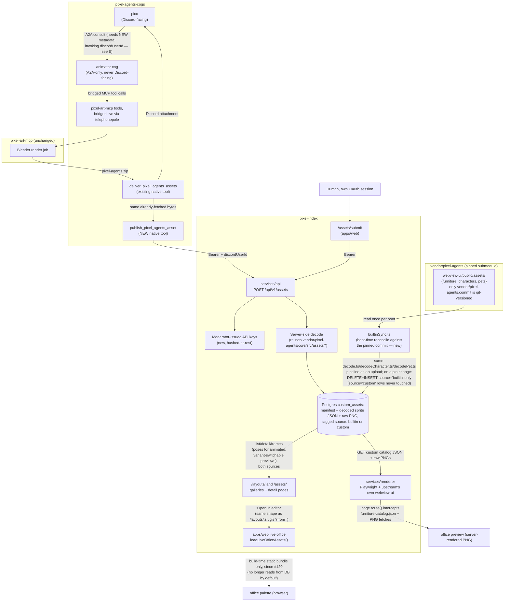

# Custom (uploadable) assets

Pixel Index lets the community — and an automated "animator agent" on the Discord bot
side — publish custom furniture, character, and pet assets, not just office layouts,
through a self-service API. This document is the design record for that feature
(#101, #105, #107/#108): the architecture as decided, what actually shipped in this
repo, and where it diverges from the original plan. It also records a follow-up piece
of work that has since landed: showing the *bundled* (built-in) Pixel Agents catalog in
the same gallery — see
[Extending the gallery to built-in assets](#extending-the-gallery-to-built-in-assets)
below.

## Status

**Complete in this repo** (`pixel-index`): upload API, moderator-issued API-key auth,
server-side decode pipeline, browser-client asset loading, renderer integration, the
`/assets/` gallery, the producer-side JSON Schema contract, and syncing the built-in
Pixel Agents catalog into the same gallery. Landed across four PRs: the storage/web-
upload "stage 1" (#104), characters and pets with a polymorphic `custom_assets` (#106,
for #105), the published JSON Schema contract (#108, for #107), and the built-in-asset
sync PR (see [Extending the gallery to built-in
assets](#extending-the-gallery-to-built-in-assets)).

**#118/#120 (superseding #101's original design):** #101's original design deliberately
made every published custom asset available everywhere — merged into the validation
catalog for any layout that referenced it, and merged into every browser editor
session's palette. #118 reverses both of those as the custom-asset catalog has grown:
issue #120 removed the submit/replace-time catalog merge (a layout referencing custom
furniture is now rejected, the same way an unknown furniture id already was) and the
browser-client catalog merge (the editor now loads built-ins only, by default). The
architecture below still documents the pieces that are unchanged (upload, decode,
gallery, renderer integration); B's description and the "API and UI" section below are
updated to reflect what #120 actually changed.

**Not in this repo, tracked separately**: the `animator` cog's `publish_pixel_agents_asset`
native tool and the generalized "requesting user" A2A context plumbing (section E below)
live in `pixel-agents-cogs`. `pixel-art-mcp` needs no changes (confirmed pure-generate).
Pre-publish preview rendering for `/assets/submit` (animated/multi-orientation) is
deliberately out of scope — split out to #102, which depends on this work and stays
unspecified until it ships. Issue #101 itself stays open until the cross-repo bot-side
work lands.

Four repos are in scope for the feature as a whole:

| Repo | Role | Outcome |
|---|---|---|
| `pixel-index` | This repo | Upload API, API-key auth, decode pipeline, browser-client asset loading, renderer integration — **done** |
| `pixel-agents-cogs` | Discord bot cogs (Pico) | New native tool on the `animator` cog, A2A metadata plumbing — **tracked separately** |
| `pixel-art-mcp` | Local Blender→sprite generator | No changes — confirmed to stay a pure local generator |
| `pixel-agents` | Upstream engine/extension (`vendor/`) | Read-only reference — nothing here changes it |

## Decisions made (by the repo owner)

1. The `animator` agent already exists at `pixel-agents-cogs/animator` — A2A-only,
   never Discord-user-facing directly; `pico` consults it. It gains one new native
   tool, `publish_pixel_agents_asset`, reusing the same `pixel-agents.zip` bytes its
   existing `deliver_pixel_agents_assets` tool already downloads — no new
   `pixel-art-mcp` call.
2. Pixel Index needs an API-key concept for machine callers. Only Moderators may
   create a key. Web uploads attribute to the authenticated web user; bot-originated
   uploads attribute to the Discord user who invoked the generation.
3. `pixel-art-mcp` stays pure-generate. No publish capability added there — a
   different threat model (trusted local code execution vs. a public, multi-tenant
   service) and no existing concept of Discord identity/capability to attribute or
   gate an upload by.
4. Upload access = Discord guild membership, nothing more. Anyone in the server can
   upload a custom asset. Whether the animator agent itself can be invoked is a
   separate, already-solved gate outside Pixel Index's permission model.
5. No moderator pre-publish review step. A valid upload goes live immediately.
6. The "requesting user" A2A context is generalized, not animator-only — every
   agent's tools will eventually see who asked.
7. Asset-id collisions never reject — they auto-suffix (`_2`, `_3`, ... first free
   integer suffix), uniformly against a built-in id or another custom asset's id. The
   upload response returns the actually-assigned id.
8. "Ghost" user records are acceptable: a bot-attributed upload may briefly be
   authored by a Discord ID with no visible Pixel Index profile, reconciled later by
   the existing login-time profile upsert if that person logs in themselves.
9. New web routes: `/` redirects to `/layouts/` (the gallery, moved there); `/assets/`
   is the new custom-asset gallery, mirroring the layout routes' shape end to end
   (list → detail → editor).
10. `/assets/submit` needs a pre-publish preview eventually, but building it is
    substantial (real engine-quality rendering for animated/multi-orientation assets)
    and is split out to #102. This issue's `/assets/submit` ships upload + validation
    only.

## End-to-end architecture

*(The `pixel-agents-cogs`/`pixel-art-mcp` half and everything under `Index` except
`BuiltinSync`/`Vendor` reproduce issue #101's own architecture diagram verbatim — the
`pixel-agents-cogs` half is aspirational/tracked-elsewhere, the rest is implemented in
this repo, see below. `Vendor`, `BuiltinSync`, and the edges into/out of them are new,
added here for the built-in-asset gallery design decided in
[Extending the gallery to built-in assets](#extending-the-gallery-to-built-in-assets)
below — not part of #101 itself. The `DB --> Gallery` edge's `frames` leg is newer
still: `GET /api/v1/assets/:assetId/sprite.png` always existed, but
`GET /api/v1/assets/:assetId/frames` — grouping a decoded asset's sprites into
per-orientation/state/direction "poses", each with its own animation frames — and the
`AssetPreview` component that animates and lets a visitor switch between them, were
added after this document's own design work, to actually animate the built-in and
custom catalogs' previews rather than showing one static PNG per asset. The
`DB --> BrowserClient` edge from #101's original diagram is gone: #120 removed the
browser's custom-catalog fetch/merge entirely, so `BrowserClient` now only ever reads
the build-time static bundle.)*

## As built, in this repo

### `services/api/src/assets/` — upload, decode, storage

- `routes.ts`, `submit.ts`, `schemas.ts`, `serialize.ts`, `query.ts`, `manifest.ts`,
  `decode.ts`, `decodeCharacter.ts`, `decodePet.ts`, `zip.ts`, `spritePng.ts` — a
  parallel module to `layouts/`, same ordering discipline (auth → cheap validation →
  expensive decode → dedupe/auto-suffix → persist).
- **One divergence from the issue's plan worth recording**: D recommended decoding by
  reusing `vendor/pixel-agents/core/src/assets/{build.ts,loader.ts}` directly. The
  actual implementation keeps a **hand-kept local copy** of the manifest schema and
  its own PNG decoder (`zip.ts`, via `pngjs`) instead — `services/api`'s
  `tsconfig.build.json` pins `rootDir: "src"`, so a static import reaching into the
  vendor submodule fails the build, the same constraint `packages/layout-core/src/upstream.ts`
  already works around for furniture-catalog validation. The local copy is also
  **stricter** than upstream's own decoder: upstream's `pngToSpriteData` only warns
  and silently misreads the buffer on a dimension mismatch, which is not the right
  default for an untrusted upload — this repo's copy rejects it.
- `custom_assets` is one polymorphic table (`assetKind: furniture | character | pet`,
  #105), manifest + decoded sprite JSON stored as `jsonb`, the original zip kept
  verbatim in `raw_zip` for provenance/future re-decode.
- Collision handling implements decision #7 exactly: `firstFreeId()` in `zip.ts`,
  checked against both `knownFurnitureIds()` (the pinned built-in catalog, from
  `@pixel-index/layout-core`) and existing custom assets.
- `services/api/src/apiKeys/` implements decision #2's machine-auth path: modeled on
  `auth/tokens.ts`'s opaque-hash primitive, not `webhooks/secret.ts`'s
  encrypt/decrypt one — a key is shown once at creation, stored hashed, moderator-gated
  to issue (`requireCapability`), same precedent as webhook subscriptions.
- `docs/custom-asset-zip-contract.md` (#107/#108) publishes the furniture/pet manifest
  JSON Schemas as the producer-side contract for pixel-art-mcp, generated from the same
  `ajv` schemas `manifest.ts`/`decodePet.ts` actually validate against at upload time
  (`services/api/src/assets/customAssetContract.test.ts` keeps this from drifting), and
  served live at `GET /api/v1/assets/schema/:kind`.

### `apps/web/src/live-office/assets.ts` — built-ins only, by default (B)

**#120 reversed this.** `loadLiveOfficeAssets()` used to also fetch the entire
custom-asset catalog (`GET /api/v1/assets/catalog`, unfiltered) and merge it into the
build-time static bundle, for both the read-only `/layouts/:slug` viewer and the
general `/editor`. It no longer does either: the palette every editor session sees is
the built-in catalog alone, keeping the web bundle's furniture surface bounded
regardless of how many custom assets have been uploaded.

**#121 added the narrower path.** `loadLiveOfficeAssets(assetId?)` takes an optional
single asset id — used only by the single-asset inspection editor below — and fetches
it from a dedicated, per-kind endpoint (`GET /api/v1/assets/:assetId/catalog`, 404 for
an unknown or builtin id), never the unfiltered catalog endpoint. Furniture merges into
the catalog/sprites pair same as the old full merge, just scoped to one asset;
character/pet append onto the built-in character/pet template arrays instead, since
those were never merged into the browser editor before #120 either (only furniture
was). Appending a character has no visible effect on its own — edit mode never rendered
any character at all before #121 — so #121 also added one fixed, non-adjustable mock
agent to edit mode (`PreviewApp.tsx`'s `EDIT_MODE_AGENT_ID`), whose palette is forced to
the appended character when one was requested, and otherwise picks a random built-in one
like `pickDiversePalette()` always has.

### `services/renderer/src/render.ts` — network-level interception (C)

Implements the recommendation, not the rejected filesystem-materialization
alternative: `page.route()` intercepts `assets/furniture-catalog.json` (appends custom
entries) and per-asset PNG fetches, scoped to that render's `page`, torn down in
`render.ts`'s existing `finally` block — no disk writes, no risk of two concurrent
renders racing over a shared directory in the one Vite dev server this service boots
once and reuses for every request. #105 extended the same pattern for character and
pet sprite fetches.

### `apps/web` routes (G)

`/` → `/layouts/` redirect; `/assets/` (`AssetsGallery.tsx`), `/assets/:id`
(`AssetDetailPage.tsx`), `/assets/submit` (`AssetSubmitPage.tsx`) mirror the layout
routes' list → detail → editor shape exactly as decided. Since #120, the general
editor's palette is built-ins-only by default (B no longer merges anything in). #121
added the per-asset alternative: `/assets/:id`'s "Open in editor" link now points at
`/editor?asset=<assetId>` — the same shared `LayoutEditorPage.tsx`/`live-office.html`
infrastructure as the general editor, plus exactly the one requested asset (any kind,
any source — including built-ins, symmetrically with #119's download button). It is
inspection-only: "Continue to publish" and "Save changes" are absent from the page
entirely in this mode, not merely disabled, and nothing drawn there can be saved.
Deliberately unrelated to #102 (pre-publish preview rendering quality for
`/assets/submit`) — this is post-publish inspection of an asset that already exists.

## Extending the gallery to built-in assets

**Decided and implemented.** `services/api/src/assets/builtinSync.ts`,
`services/api/src/db/sync-builtin-assets.ts`, the `query.ts`/`serialize.ts`/
`schemas.ts`/`routes.ts` scoping fixes, and the `apps/web` gallery/detail
changes below all landed together.

Today, `/assets/` (`AssetsGallery.tsx`) only lists rows from `custom_assets` via
`GET /api/v1/assets` — every asset a human or the animator has uploaded. It shows
nothing from the ~24 furniture items, 6 characters, and 2 pets **bundled with the
pinned Pixel Agents webview itself** (`vendor/pixel-agents/webview-ui/public/assets/`).
Those already have three separate consumers in this codebase today, each reading the
pinned local checkout directly, none reaching the network for it:

1. **`apps/web/build/liveOfficeAssets.ts`** (Vite plugin) — decodes the full built-in
   catalog (furniture, characters, floors, walls, carpets, pets) **at web-app build
   time**, using `vendor/pixel-agents/core/src/assets/{build,loader,pngDecoder}.ts`
   directly (importable here because `apps/web`'s build script isn't bound by
   `services/api`'s `rootDir: "src"` constraint). Output is written under a
   commit-pinned URL (`assets/pixel-agents/<commit>/...`) so CDN caching never serves a
   stale file after a vendor bump — the pin is part of every URL.
2. **`packages/layout-core/src/upstream.ts`**'s `furnitureCatalog()` — reads
   `assets/furniture/*/manifest.json` from the local checkout **at runtime** (both API
   and renderer), for id→placement-property validation only (no sprite pixels).
3. **`services/renderer/src/devServer.ts`** — boots upstream's *own* unmodified
   webview-ui as a real Vite dev server against the local checkout, decoding assets
   however upstream's own dev-mode browser mock does, **at process boot**.

The constant across all three: the submodule pin (`vendor/pixel-agents.commit`, a
40-character commit SHA) is the only thing about the built-in catalog that is
git-versioned in this repo. The actual manifest/PNG bytes live in the `pixel-agents`
repo at that commit and are pulled in by `git submodule update` — never duplicated as
a second, hand-copied set of files inside `pixel-index`.

### Decided design: sync built-ins into `custom_assets`, single endpoint, tagged by source

Rejected the three build-time/runtime/live-fetch options originally drafted here (kept
in git history) in favor of a fourth, chosen by the owner: **built-in assets are
decoded and written into the same `custom_assets` table custom uploads already use,
tagged with a `source` column, kept in sync with the pinned commit by an idempotent
reconciliation step that never touches `source = 'custom'` rows.** This gives the
single unified `GET /api/v1/assets` endpoint (list, detail, sprite.png — all three,
for both origins) the owner asked for, while still treating the vendor pin, not a
git-committed copy, as the only source of truth for what a "current" built-in asset is.

**Schema (`custom_assets`, new migration):**

- `source: 'builtin' | 'custom'` (new enum column, not null). Every row existing today
  backfills to `'custom'`.
- `sourceCommit: text, nullable` — the `vendor/pixel-agents.commit` SHA a `'builtin'`
  row was decoded from; `null` for `'custom'` rows. This is what makes the
  reconciliation idempotent: a sync run compares the current pin against what's
  already stored and can no-op when nothing changed, instead of re-decoding on every
  boot.
- `authorUserId` stays `NOT NULL` (unchanged) — built-in rows point at a **second
  reserved system user** (migration `0016_pixel_agents_system_user.sql`, username
  `pixel-agents`, `discordId: null`), not the existing ghost-user mechanism
  (`resolveOrCreateGhostUser`) decision #8 introduced: a ghost user always carries a
  *real* Discord snowflake, just one not yet fetched — the wrong shape for an asset
  with no associated Discord user at all. It's also kept distinct from the seed-layout
  system user (`SYSTEM_USER_ID`, username `pixel-index`): `GET /api/v1/assets` is a
  public API that always populates `author.username`, so reusing the seed owner would
  make every built-in asset's API response claim "authored by pixel-index" — wrong
  provenance. The gallery/detail UI shows `source = 'builtin'` (see below) instead of
  ever rendering that system user as if they were a real contributor.
- `custom_assets_asset_id_format`'s `^[A-Z][A-Z0-9_]*$` check needs the built-in pet
  ids (`gitcat`, `claudio` — lowercase in the vendor tree) upper-cased on the way in
  (`GITCAT`, `CLAUDIO`); furniture and a synthesized character id scheme
  (`CHAR_0`..`CHAR_5`, since upstream characters are purely positional, no id at all —
  `decodeCharacter.ts`'s own doc comment) already fit the existing constraint
  unchanged.

**Reconciliation step, not a request-time decode:**

- New module, e.g. `services/api/src/assets/builtinSync.ts`, invoked once at boot —
  wired into `docker-entrypoint.sh` as a new idempotent step, the same shape
  migrations/backfills/seeding already are there ("all steps are idempotent, so
  running them before every start... is intended, not wasteful").
- On each boot: read the current pin (`upstreamPin()`), compare against the
  `sourceCommit` already stored for `source = 'builtin'` rows. If they match, no-op —
  most restarts (no vendor bump) pay zero decode cost. If they differ (a fresh
  install, or a deploy that bumped the pin), decode the full built-in catalog and, in
  **one transaction**, `DELETE FROM custom_assets WHERE source = 'builtin'` followed
  by a bulk insert of the freshly decoded rows — Postgres's MVCC means concurrent
  reads see either the complete old set or the complete new set, never a partial one,
  so there's no gallery flash-of-empty during a resync. The `WHERE source = 'builtin'`
  scoping is exactly what keeps `source = 'custom'` rows untouched — this is the "old
  built-ins from a superseded webview build get dropped, custom assets never do"
  guarantee.
- **Decode reuse, not a second decoder**: `decode.ts`/`decodeCharacter.ts`/`decodePet.ts`
  already implement the exact hand-kept manifest/PNG decode logic this needs — they
  take a zip `Buffer` and parse it themselves (`JSZip.loadAsync` internally), not a
  `JSZip` instance. `builtinSync.ts` builds an in-memory `JSZip` from the vendor tree's
  on-disk files (`assets/furniture/<ID>/{manifest.json,*.png}`,
  `assets/characters/char_N.png`, `assets/pets/<id>/{manifest.json,pet.png}`),
  serializes it back to a `Buffer` (`generateAsync({type:'nodebuffer'})`), and feeds
  that through those same functions unmodified — a required two-hop round trip given
  their actual signatures, not a shortcut — so a built-in asset is validated and
  decoded by **exactly** the same code path an upload goes through, not a parallel one
  that could drift.
- Auto-suffix collision checking (`firstFreeId()` against `knownFurnitureIds()`, the
  local vendor checkout) becomes partially redundant once built-ins are DB rows too —
  the DB itself could answer "is this id taken" for both origins in one place. Not
  changing that in this pass; flagged as a natural follow-up cleanup, not required for
  this feature.

**API and UI:**

- `GET /api/v1/assets`, `/assets/:id`, `/assets/:id/sprite.png` needed no new routes —
  they already read `custom_assets`; rows can now have `source: 'builtin'`, surfaced in
  `toSummary()`/`toDetail()` (`serialize.ts`) and the response schemas.
  `allCustomAssetCatalog()`/`customAssetsOfKind()` (`query.ts`) — the two functions
  feeding the renderer's per-layout furniture/character/pet injection (B's browser-side
  catalog merge was removed by #120; these now only feed the renderer, C) — are scoped
  to `source = 'custom'` only, since both consumers already independently draw every
  built-in asset from elsewhere (the browser's own build-time bundle; the renderer's
  dev-server-hosted, unmodified webview-ui); without that scoping, every built-in asset
  would render twice.
- **Same grid, interleaved** — `AssetsGallery.tsx`'s list shows a "Built-in" badge on
  `AssetCard.tsx` only for `source: 'builtin'` (its absence is the "community" signal),
  and `AssetFilterBar.tsx` gained a Source filter (Any/Built-in/Community) alongside
  its existing Category one.
- **Full detail page** — `AssetDetailPage.tsx` handles `source: 'builtin'` the same
  shape as a custom asset (preview, manifest metadata, "open in editor"), with the
  author line replaced by a plain "Built-in — bundled with Pixel Agents" notice instead
  of a user link. No Pixel Agents version number in the notice — `sourceCommit` is an
  internal reconciliation key, not exposed publicly, and adding a version field just
  for one sentence of copy wasn't judged worth new API surface.

Resolved during implementation:

1. Character ids: `builtinSync.ts` calls `decodeCharacterZip` with `name: 'Char ${n}'`
   for `n` in `0..5` — its existing name-slugifying id derivation already turns that
   into `CHAR_0`..`CHAR_5` with no new id logic needed. Pet ids: a *synthetic* manifest
   (`{id: vendorId.toUpperCase(), name: vendorName}`) is fed to `decodePetZip` rather
   than the vendor file's bytes verbatim, so `gitcat`/`claudio` become `GITCAT`/`CLAUDIO`
   while `name` keeps its original casing for display.
2. `sync-builtin-assets.ts` runs as its own `docker-entrypoint.sh` step, after
   `seed.js` — consistent with every other idempotent boot task there.

## Character profiles and soundtracks

Pixel Agents' cast is no longer a set of bundled `char_N.png` sprite sheets. Each
character is a **profile**: a wardrobe part per slot, colours and pixel edits, which
the webview composes into a sheet (`webview-ui/src/characters/`). The Characters view
saves one with *Save config* (a `.json`) and reads one back with *Load config*. The
office also has a **radio** whose every tune is fully determined by a **song code**
(`TOWN-5-8F3A21C0`: mood, root, seed — `webview-ui/src/music/songCode.ts`). Both are
things people make and want to show off, so the index lets them publish their
favourites.

### Character profiles: a `character` asset tagged `profile`

A profile *is* importable (the `.json` that *Load config* takes), so it lives in
`custom_assets`, as an ordinary `character` row with two additions:
`manifest[0].profile` holds the profile itself, and the row is tagged `profile`
(`assets/tags.ts`, filterable as `GET /api/v1/assets?profile=true`; the gallery's
Kind filter calls it "Character profile"). Its `sprites` are the composed office
sprites, the same shape a sprite-sheet character stores, so every reader of character
rows works on it unchanged: the gallery thumbnail and poses, the single-asset editor,
layout renders and the export zip.

- **Upload** — `POST /api/v1/assets` with `content-type: application/json` and the
  config file as the body (`?fileName=` names an unnamed profile the way *Load config*
  does). One character per upload; a roster is refused. `assets/decodeProfile.ts`.
- **Composition happens in the renderer, with upstream's own code.** The API can't run
  vendor TypeScript, and a hand-kept copy of the wardrobe and its renderer would drift
  with every art change. The renderer service already runs the pinned upstream's dev
  server in Chromium, so `POST /compose-character` imports upstream's
  `characters/profiles.ts` (`parseConfigFile`: the exact validation, migration and
  naming *Load config* runs), `loadWardrobe.ts` and `renderer.ts` into a page and
  composes the sheet there. What the index accepts and draws is what Pixel Agents
  would.
- **Download** — `GET /api/v1/assets/:assetId/profile.json` (the "Download config"
  button, offered for built-in profiles too). The export zip writes
  `character-profiles/<assetId>.json` beside the `char_N.png` sheet, which still works
  as an external character as it is.
- **Built-ins** — the six built-in characters are upstream's
  `DEFAULT_CHARACTER_PROFILES`, published as built-in profiles under the ids the
  bundled sheets had (`CHAR_0`…`CHAR_5`). The API image carries no vendor TypeScript,
  so `services/api/src/assets/builtinProfiles.json` (each profile plus its composed
  sheet) is generated with upstream's renderer by `npm run builtin-profiles`
  (`apps/web/build/generateBuiltinProfiles.ts`); CI's `builtin-profiles:check` fails a
  vendor bump that changes the default cast or its art until it is regenerated.

### The character designer: Pixel Agents' own Characters view, in the index

`/assets/design` lets a user design a character without leaving the index (or having
Pixel Agents installed). Upstream's Characters view runs **unmodified** in the
`character-designer.html` frame (`apps/web/src/live-office/DesignerApp.tsx`), the same
way the layout editor runs upstream's editor in `live-office.html`:

- The view edits upstream's `castStore`, which saves the whole cast over the transport
  and waits for the server's answer. The index's transport stub
  (`live-office/transport.ts`, inert for every other frame) hands that one message to
  the designer, which plays the server: the cast is kept in this browser's
  `localStorage` and the save is answered at once, so Save, undo and the dirty-close
  prompt all behave as in Pixel Agents. A fresh browser starts from upstream's six
  default characters.
- The page around the frame (`routes/CharacterDesignerPage.tsx`,
  `live-office/designerProtocol.ts`) shows **Publish "‹name›"** for the character on the
  stage (unsaved edits included) and uploads it exactly like a config file chosen on
  `/assets/submit`. `?from=<assetId>` (a profile's **Remix in the designer** button)
  opens a copy of a published profile under a fresh id.
- A character wearing a **custom item** (a part saved from the pixel editor) can't be
  published as it looks: a character config doesn't carry custom items — upstream's own
  *Save config* doesn't either — so the page says so and disables Publish.

#### Seeds: a character from any text, like an identicon

Above the frame, **Start from a seed** (`components/SeedPanel.tsx`, `seeds.ts`) makes a
character from a seed with the index's own avatar package,
[`@pixel-index/pixatar`](../packages/pixatar/README.md), and dresses the character on
the stage as it (the frame's `wear` command: one undo step, the character keeps its id
and name). It works both ways: whatever is on the stage, however it got there, is shown
with its seed code, its 20×20 avatar on a background colour derived from the seed, its
walk/type/read animation and PNG downloads (avatar at 20–320 px, sprite sheet), so every
edit in the Characters view makes a new seed. Publish then publishes it like any other
character. The two kinds of seed promise different things:

- **Free text** (a name, an email address, a user id) is hashed into a character, which
  appears as you type. The same text makes the same character at a given vendor pin. A
  bump that adds wardrobe parts can deal it differently.
- **A seed code** (`px.` + base64url) *is* the character, written down: its exact parts
  and colours, and whether its avatar is transparent (the **Transparent avatar**
  toggle). It keeps its character across versions, as long as Pixel Agents keeps the
  parts it names. A text's code is what to keep to hold on to its character for good.

`/assets/design?seed=px.…` and `?text=…` open the designer on a seed (`?from=` wins when
both are given). After a seed has been used on the page, the address follows the
character, so **Copy link** shares it. These are query parameters rather than pixatar's
original `#px.` / `#t.` fragments, because the index's sign-in already arrives in the
fragment.

### Soundtracks: their own table

A song code is the whole tune: there is no audio, no sprite and no file to import, only
the text to paste into the radio's settings. None of `custom_assets`'
manifest/sprite/zip machinery has anything to hold, so soundtracks are a small table of
their own (`soundtracks`: canonical code, mood, optional title, author, soft delete),
with `GET/POST /api/v1/soundtracks`, `GET/DELETE /api/v1/soundtracks/:id`
(`services/api/src/soundtracks/`). The code is validated and canonicalised by a
hand-kept copy of upstream's `parseSongCode` (`songCode.ts`), checked against
upstream's own parser by `songCode.test.ts`. One entry per tune per publisher.

`/soundtracks` shows each code with a one-click **Copy**, and **Play** hears it on
**Pixel Agents' own radio player, unmodified** (`music/MusicPlayer.tsx`: play, skip,
volume, the visualizer and its settings panel with the moods and the song code to copy
or paste and play), in the `radio.html` frame (`live-office/RadioApp.tsx`,
`radioProtocol.ts`) pinned to the page's bottom-right corner as it sits in the office.
It's a frame because vendor code only compiles in `src/live-office` and upstream's
Tailwind theme redefines the site's tokens. It's transparent and sized to the player as
the frame reports it (the settings panel opens above the bar), so the page stays
clickable around it. Browsers start audio only from a click inside the playing document,
so when a page-side Play is refused the player's own ▶ always works. The player's
*Hide player* points at Pixel Agents' Settings, which the index doesn't have, so the page
shows **Show the radio** while it's hidden, and playing a soundtrack brings it back.

The publish form also lets anyone **try a code before publishing**: as it's typed, the
frame checks it with upstream's parser and names it with upstream's composer, and
**Try it** plays it on that same player. A code the radio can't play is flagged and
can't be published. Author pages list a publisher's soundtracks beside their assets.

## See also

- [`ARCHITECTURE.md`](ARCHITECTURE.md) — the four-service shape this feature slots
  into.
- [`custom-asset-zip-contract.md`](custom-asset-zip-contract.md) — the producer-side
  zip/manifest contract (#107/#108), for anyone generating upload zips outside this
  repo.
- [`deployment.md`](deployment.md) — environment model; relevant since built-in assets
  are pinned per-environment via the same `vendor/pixel-agents.commit` every other
  consumer reads.
